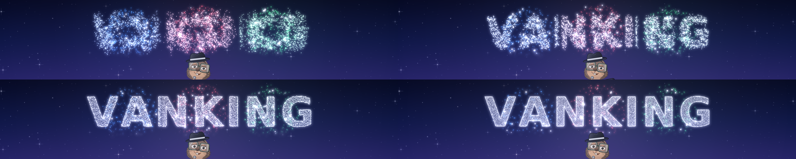
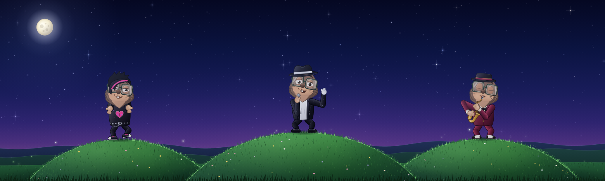

# VANKING.UZ — Mole Music Show (Video1s)

A **15-second, perfectly seamless-loop** animated concert: three VANKING.UZ mole mascots perform on
three hills under a starry evening sky while blue, red and green fireworks launch every four seconds
and their sparks assemble into the glowing white word **VANKING**.




* Spec: [`docs/TECHNICAL_SPECIFICATION_VANKING.UZ.txt`](docs/TECHNICAL_SPECIFICATION_VANKING.UZ.txt)
* Progress log: [`PROGRESS.md`](PROGRESS.md)
* Loop validation report: [`docs/loop-validation-left.md`](docs/loop-validation-left.md)
* Brand source art (official mascot SVGs): [`assets/brand/`](assets/brand)

## Deliverables

Full-resolution renders are attached to the GitHub Release **v1.0** (too large for git).
Small previews and the soundtrack live in [`deliverables/`](deliverables).

| Set | Left 6240 × 1872 | Center 11752 × 1872 | Right 6864 × 1872 |
|---|---|---|---|
| **Standalone** — full scene composed for each screen | `VANKING_MoleShow_15s_STANDALONE_left_6240x1872.mp4` | `…_STANDALONE_center_11752x1872.mp4` | `…_STANDALONE_right_6864x1872.mp4` |
| **Spanned** — one panorama across Left │ Center │ Right | `VANKING_MoleShow_15s_SPANNED_left_6240x1872.mp4` | `…_SPANNED_center_11752x1872.mp4` | `…_SPANNED_right_6864x1872.mp4` |

* Video: H.264 High, yuv420p, 30 fps, exactly 450 frames (15.000 s), CRF 16, closed loop
  (frame 450 would be identical to frame 0). Audio: AAC 320 kb/s, 48 kHz stereo.
* `soundtrack.wav` — 48 kHz / 16-bit, exactly 720 000 samples, sample-exact loop. For gap-free
  looping on a media server use this WAV (MP4/AAC adds encoder priming samples at the start).
* The layout drawing for the three screens was not part of the request, so both interpretations are
  delivered: use **Spanned** if the screens sit side by side as one canvas, **Standalone** if each
  screen should show the complete scene.
* The 11752-px-wide H.264 file requires a decoder that supports H.264 level 6.x (software decoders,
  media servers); many hardware TV decoders stop at 4096 px.

## What's in the animation

| Time | Events |
|---|---|
| 0.0–1.0 s | All moles already performing; three rockets (blue / red / green) rise from behind the hills. |
| 1.0–2.0 s | Bursts with flash, streaks and crackle; part of the sparks fly into letters and turn white. |
| 2.0–3.0 s | **VANKING** holds ~1 s, shimmering — the singer sings "Van-king!" |
| 3.0–4.0 s | Letters crumble, particles fall, shrink and fade before reaching the ground. |
| 4–8 s, 8–12 s | Cycles 2 and 3 (8–12 s: sax-led section, singer's extra gestures, foot slide). |
| 12–15 s | Compressed 4th cycle (burst 12.5 s, hold 13.25–14.25 s, gone by 14.93 s) → loops to 0 s. |

| Hill | Character | Look | Performance |
|---|---|---|---|
| Center | Lead singer | MJ-inspired: black sequinned jacket, white tee, fedora, single sparkling white glove, white socks, black loafers | Lip-synced singing into a handheld mic, toe taps, heel-toe, foot slide, pointing at the fireworks, two hat touches, accent twists |
| Right | Jazz saxophonist | Burgundy suit, cream shirt, bow tie, gold pocket square, pork-pie hat, two-tone shoes | Golden sax at the mouth (buck teeth on the mouthpiece), fingering synced to the notes, cheeks puff, sway, knee dips, sax lifts on accents, eyes close on long notes |
| Left | Emo Tecktonik dancer | Black tee with pink heart `</>`, skinny jeans, studded belt + chain, wristbands, fringe with pink streak, pink-laced sneakers | Arm circles around the head, rolling forearms, cross-body sweeps, elbow pops, arm waves, step footwork, double-time during firework accents |

Music: 120 BPM pop-funk / electro (E dorian) — drums, disco-funk octave bass, synth saxophone,
talk-box style vocal, electro arp & stabs, plus launch whistles, booms, crackles, shimmer and glitter
synchronised with every firework. The **same score drives the audio and the animation** (lip-sync,
fingering, accents), so picture and sound stay locked on every repeat.

## How the seamless loop is guaranteed

* Every animated value is a pure function of `t ∈ [0, 15)` built from terms with periods that divide
  15 s (beats of 0.5 s, sways of 1/1.5/2.5/3 s, twinkles of 15/k s …) or from periodic splines /
  smooth bumps on a circular timeline — no simulation state is carried between frames.
* Fireworks are closed-form particle trajectories; the 4th cycle finishes before 14.93 s.
* Audio is synthesised into a circular 15 s buffer (tails wrap to the start); reverb and delay are
  run to steady state, dither is identical every repeat.
* `scripts/validate-loop.mjs` checks: `render(15) == render(0)` pixel-exactly, pose continuity at
  240 Hz across the seam, the 449→0 frame difference vs all other transitions, and sample-identical
  audio repeats.

## Build & render

Requirements: Node ≥ 20, ffmpeg (with libx264), the DejaVu Sans Bold font (only for `build-text`).

```bash
npm install
node scripts/extract-mascot.mjs          # brand SVG → src/assets/mascot-head.js
node scripts/build-text.mjs              # "VANKING" particle targets → src/assets/vanking-text.js
node audio/build-soundtrack.mjs          # → out/audio/soundtrack.wav (+ 5× loop test file)
node scripts/still.mjs --screen center --t 2.5 --scale 0.25        # review stills
node scripts/validate-loop.mjs --screen left --scale 0.1           # loop checks
node scripts/render.mjs --mode standalone --screens left,center,right --workers 3 --workers-center 2
node scripts/render.mjs --mode spanned    --screens left,center,right --workers 3 --workers-center 2
```

Live preview in a browser: run `python3 -m http.server` in the repo root and open
`http://localhost:8000/preview/` (renders in real time with the soundtrack).

## Project structure

```
src/
  config.js            timing (15 s, 120 BPM, 30 fps), screens, firework cycles, colours
  layout.js            standalone & spanned compositions (world units: screen height = 1000)
  render.js / show.js  frame compositor; per-character lit layers
  scene/environment.js sky, moon, stars, hills, grass, fireflies, firework light on the ground
  characters/          head (brand art, blink/lids/mouths), rig (IK limbs, paws, shoes), outfits & props,
                       singer.js, sax.js, emo.js (choreography)
  fx/fireworks.js      rockets, bursts, particle text, crumble, bloom, lights
  music/score.js       the score shared by audio and animation; sync.js = lip-sync / fingering
audio/                 DSP toolkit + soundtrack builder
scripts/               extraction, stills, render pipeline, loop validator
preview/               browser live preview
assets/brand/          official mascot SVGs (source of the character heads)
```

## Notes

The spec asks for "stylized 3D animation". The piece is rendered as high-end **2.5D vector animation**
(cylinder-shaded limbs, moonlight & firework lighting, bloom, depth layers) so that the official brand
vector artwork is used exactly and the very large LED resolutions render in minutes. The soundtrack
is fully synthesised (no samples or third-party recordings).
